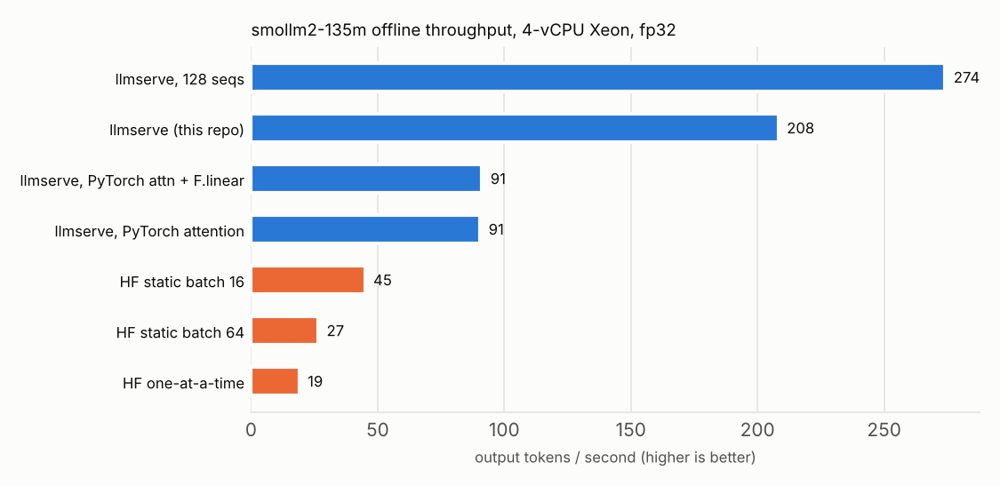
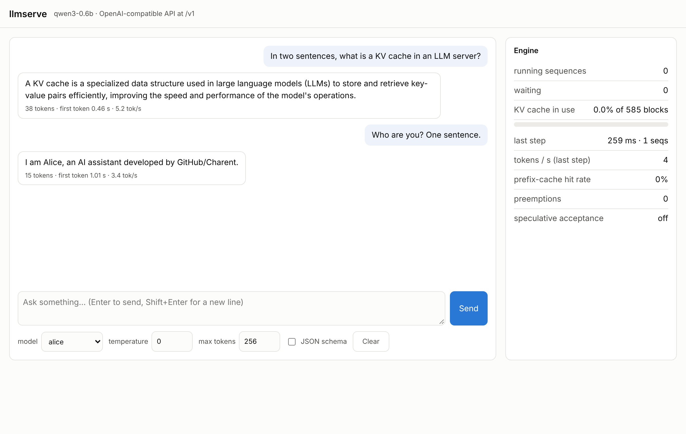

# llm-serving-engine

**An LLM inference and serving engine written from scratch in PyTorch + C++.** Paged KV cache,
continuous batching, chunked prefill, prefix caching, speculative decoding, int8/int4
quantization with custom kernels, structured (JSON-schema) output, multi-LoRA serving, and an
OpenAI-compatible streaming API with a web console. It runs Llama-family (SmolLM2) and Qwen3
checkpoints and its output is checked token-for-token against Hugging Face transformers.

Everything was built and measured on a **4-vCPU cloud Xeon with no GPU**; every number below is a
CPU number and comes from a JSON file in [`results/`](results/) (the CPU is printed under each
table in [`results/README.md`](results/README.md)).



## Headline results

| | result |
|---|---|
| **Throughput vs HF transformers** (SmolLM2-135M, 200 ShareGPT requests) | **274 vs 19 tok/s (14x)** one-request-at-a-time; **6x** vs HF static batching |
| **Serving under load** (Poisson arrivals, 1.5 req/s) | **99%** of requests meet a 2 s TTFT / 250 ms TPOT SLO (TTFT p99 0.89 s) vs **1%** for HF static batching (TTFT p99 179 s) |
| **Chunked prefill** (2048-token prompt arrives while 8 streams decode) | worst decode stall **5.8 s -> 0.7 s** |
| **Prefix caching** (shared 1024-token system prompt) | TTFT p50 **0.26 s vs 31.8 s** without it; **2.8x** throughput (SmolLM2-135M), **4x** (Qwen3-0.6B) |
| **Speculative decoding** (SmolLM2-1.7B, single stream) | **2.9x** faster with n-gram lookup on a rewrite task (91% acceptance), **1.4x** with a 135M draft model on chat; correctly *slower* (0.85-0.91x) at batch 8 |
| **Custom C++ kernels** | paged attention **2.3x** end-to-end throughput over gather + SDPA; int8 GEMV **3x** faster than fp32 per layer at batch 1, where PyTorch's int8 kernel is 3x *slower* |
| **Quantization** (Qwen3-0.6B) | int8: **1.7-1.8x** faster single-stream decode at +2% perplexity; int4 + AWQ-style scaling: 4x smaller linear layers at +8-13% perplexity (plain int4: +18-35%) |
| **Correctness** | 90 tests: HF logit/greedy parity, every optimization vs the plain path, lossless speculative sampling (statistical test), every structured-output sample parses and validates |

## What is inside

```
 HTTP / OpenAI API (SSE)         web console at /          offline LLM.generate()
          │                             │                           │
          └──────────── AsyncEngine (engine on its own thread) ─────┘
                                        │
 ┌──────────────────────────── LLMEngine.step() ─────────────────────────────┐
 │ Scheduler     continuous batching, token budget, chunked prefill,         │
 │               preemption by recompute, decode-first                       │
 │ BlockManager  paged KV blocks, ref counts, hash-chained prefix cache with │
 │               LRU eviction, copy-on-write for parallel sampling (n > 1)   │
 │ ModelRunner   ragged batch: flat tokens + per-sequence attention metadata │
 │ Model         own Llama/Qwen3 code; oneDNN prepacked linears; C++ paged   │
 │               attention; int8/int4 linears with own C++ GEMV kernels      │
 │ Sampler       temperature/top-k/top-p/min-p/penalties, per-request seeds, │
 │               logprobs, JSON-schema/regex token masks                     │
 │ SpecDecode    n-gram or draft-model proposer, lossless rejection sampling │
 │ LoRA          many PEFT adapters in one batch over one base model         │
 └───────────────────────────────────────────────────────────────────────────┘
```

Design notes, with the reasoning and the measurements behind each choice:
[`docs/design.md`](docs/design.md). Full write-up of every experiment: [`docs/report.md`](docs/report.md).

| Feature | Where | Verified by |
|---|---|---|
| Transformer from scratch (RoPE, GQA, SwiGLU, Qwen3 q/k-norm, fused projections) | `models/` | logits within 3e-5 of HF, identical greedy tokens |
| Paged KV cache + block allocator | `kv_cache.py`, `block_manager.py` | allocator invariants, paged == contiguous |
| Continuous batching, chunked prefill, preemption | `scheduler.py` | same output with each feature on/off |
| Prefix caching (hash chain, LRU) and copy-on-write | `block_manager.py` | hit/eviction tests, identical outputs |
| C++ paged-attention kernel (GQA-grouped, OpenMP via ATen) | `kernels/csrc/paged_attention.cpp` | vs PyTorch reference and dense SDPA |
| Speculative decoding (n-gram, draft model) | `spec_decode/` | identical greedy output; distribution test |
| int8 (own GEMV + W8A8 `_int_mm`) / int4 (own GEMV) / AWQ-style scaling | `quant.py`, `kernels/csrc/int8_gemv.cpp` | vs dequantized reference; WikiText-2 perplexity |
| Structured output: regex -> byte DFA, JSON schema -> regex | `structured/` | vs Python `re`; every sample validated |
| Multi-LoRA (fused-slice updates, adapter-aware prefix cache) | `lora.py` | vs merged-weight models; cache isolation |
| OpenAI-compatible server, SSE, Prometheus, web console | `server/` | official `openai` client tests |

## Quickstart

```bash
uv venv --python python3.13 .venv && uv sync --extra dev
```

```bash
.venv/bin/llmserve generate "The capital of France is" --model qwen3-0.6b
```

```bash
.venv/bin/llmserve serve --model qwen3-0.6b --lora alice=models/lora/self_cognition_Alice
```

Then open http://127.0.0.1:8000/ for the console, or use any OpenAI client:

```python
from openai import OpenAI

client = OpenAI(base_url="http://127.0.0.1:8000/v1", api_key="none")
r = client.chat.completions.create(
    model="qwen3-0.6b",
    messages=[{"role": "user", "content": "Name a city and its population."}],
    response_format={
        "type": "json_schema",
        "json_schema": {
            "name": "city",
            "schema": {
                "type": "object",
                "properties": {"city": {"type": "string"}, "population": {"type": "integer"}},
            },
        },
    },
)
print(r.choices[0].message.content)  # always valid JSON for that schema
```

Offline batch API:

```python
from llmserve import LLM, SamplingParams

llm = LLM("qwen3-0.6b", speculative="ngram")
outs = llm.generate(["Summarize: ..."], SamplingParams(temperature=0, max_tokens=64))
```



## Reproducing the numbers

Benchmarks are queues of commands; each writes a JSON with the git SHA, CPU, torch version and
full config, and a re-run skips results that exist.

```bash
scripts/run_queues.sh benchmarks/queues/m4_offline.txt benchmarks/queues/m4m5_online.txt
```

```bash
.venv/bin/python benchmarks/report.py
```

## Limitations and honest notes

* **CPU only.** The code is device-agnostic PyTorch, but nothing here was measured on a GPU and no
  GPU claims are made. Absolute speeds are small (a 4-vCPU VM); the comparisons are the point.
* **The cloud VM changed CPU twice** across container restarts (2.8 GHz AVX-512 / 2.1 GHz with
  AMX). Every table comes from a single CPU, printed under it; tables are not compared across CPUs.
* **int4 is a memory saving, not a batch speedup.** Its kernel wins only at 1-2 rows; batched int4
  is slower than fp32. Qwen3's fp32 embedding/LM head (622 MB) also limits what quantizing the
  linear layers can save.
* **W8A8 costs a little quality.** int8 uses exact weight-only math for decode (<= 4 rows) and
  quantizes activations for larger batches, which is where the +2% perplexity comes from
  (weight-only int8 alone measured +0.3%).
* **torch.compile did not help** (198.6 vs 208.3 tok/s): the linear layers already use the same
  prepacked oneDNN kernels Inductor would pick, and shape changes trigger recompiles. It is off by
  default.
* **Mistakes caught on the way** are logged in [`PROGRESS.md`](PROGRESS.md), including a benchmark
  run discarded for overlapping a model download, and an engine bug that silently ignored the
  linear-backend/quantization options (found because results record the backend that actually ran).

## Project layout

| Path | What |
|---|---|
| `src/llmserve/` | engine, model, kernels, server |
| `tests/` | 90 tests on tiny random models (CI) + real-checkpoint tests (`-m slow`) |
| `benchmarks/` | workloads, queues, microbenchmarks, report builder |
| `results/` | every result JSON, tables and charts |
| `docs/` | design notes, report, screenshots |
| `PLAN.md`, `PROGRESS.md` | plan with decision log; working log |
