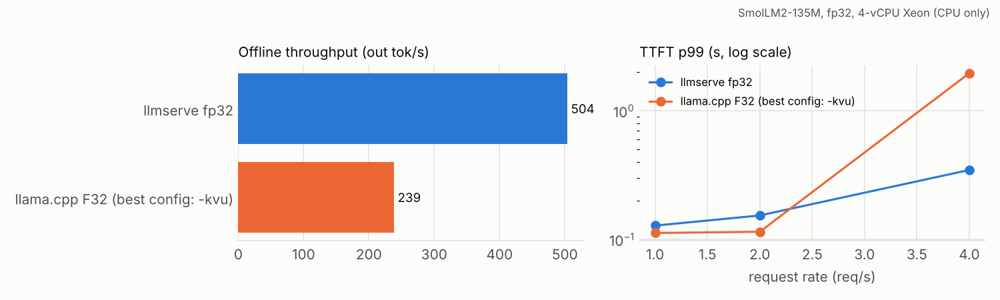
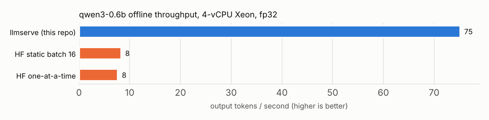
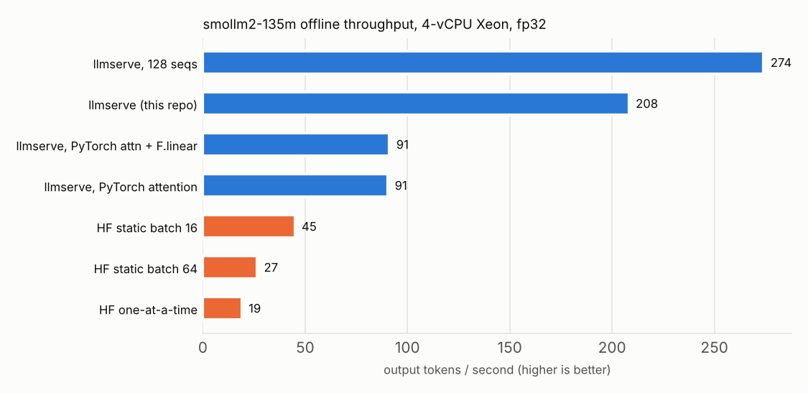
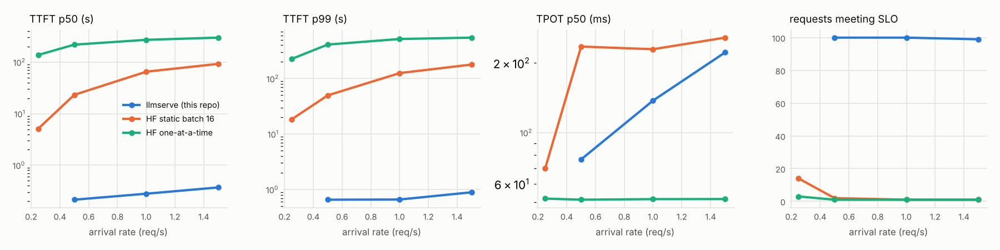

# Benchmark results

Generated by `benchmarks/report.py` from the JSON files in this folder.

## Head-to-head: llmserve vs llama.cpp server (SmolLM2-135M-Instruct)

Both servers driven by `llmserve loadtest` (OpenAI `/v1/completions`, token-id prompts, greedy, `ignore_eos`, same ShareGPT requests and output lengths), 4 threads, 64 parallel sequences, fp32 KV cache. `inf` = all 200 requests at t=0; other rates are Poisson arrivals, 100 requests.

_CPU: Intel(R) Xeon(R) Processor, 4 threads, fp32._

| system | rate (req/s) | out tok/s | TTFT p50 ms | TTFT p99 ms | TPOT p50 ms |
|---|---|---:|---:|---:|---:|
| llmserve fp32 | 1.0 | 110.9 | 110 | 188 | 50.5 |
| llmserve fp32 | 2.0 | 207.1 | 141 | 262 | 68.7 |
| llmserve fp32 | 4.0 | 328.9 | 213 | 367 | 117.4 |
| llmserve fp32 | inf | 369.5 | 22452 | 48302 | 157.1 |
| llama.cpp F32 (best config: -kvu) | 1.0 | 114.5 | 52 | 104 | 21.6 |
| llama.cpp F32 (best config: -kvu) | 2.0 | 218.2 | 87 | 155 | 45.1 |
| llama.cpp F32 (best config: -kvu) | 4.0 | 252.1 | 215 | 3842 | 181.1 |
| llama.cpp F32 (best config: -kvu) | inf | 231.6 | 36254 | 80847 | 251.5 |
| llama.cpp F32 (default KV) | 1.0 | 95.2 | 442 | 695 | 286.2 |
| llama.cpp F32 (default KV) | 2.0 | 142.1 | 412 | 2615 | 290.8 |
| llama.cpp F32 (default KV) | 4.0 | 150.2 | 535 | 18543 | 291.8 |
| llama.cpp F32 (default KV) | inf | 179.2 | 43463 | 97611 | 326.4 |
| llmserve int8 weights | 2.0 | 204.2 | 153 | 291 | 75.9 |
| llmserve int8 weights | inf | 314.6 | 27363 | 57832 | 191.9 |
| llama.cpp Q8_0 (-kvu) | 2.0 | 228.7 | 34 | 126 | 10.9 |
| llama.cpp Q8_0 (-kvu) | inf | 292.4 | 27593 | 62938 | 203.0 |
| llama.cpp Q8_0 (default KV) | 2.0 | 202.6 | 163 | 263 | 109.0 |
| llama.cpp Q8_0 (default KV) | inf | 234.0 | 38090 | 77838 | 261.2 |

llama.cpp configuration sweep (offline, F32): fa-on 180 tok/s, np16-fa-on 176 tok/s, np16 178 tok/s, np32 184 tok/s, np64-unified 231 tok/s. _CPU: Intel(R) Xeon(R) Processor, 4 threads, fp32._

## Offline throughput (ShareGPT, all requests at t=0, CPU)

### qwen3-0.6b: 100 requests, mean prompt 67 / output 118 tokens (workload 8a95dd027e51)

_CPU: Intel(R) Xeon(R) Processor @ 2.80GHz, 4 threads, fp32._

| system | output tok/s | req/s | vs HF one-at-a-time | duration s | git |
|---|---:|---:|---:|---:|---|
| llmserve (this repo) | 75.1 | 0.64 | 9.8x | 157 | 6a32c4b |
| HF static batch 16 | 8.3 | 0.07 | 1.1x | 1420 | 27bc92a |
| HF one-at-a-time | 7.7 | 0.06 | 1.0x | 1542 | 53dd63f |

### smollm2-135m: 200 requests, mean prompt 69 / output 118 tokens (workload b21c622b2484)

_CPU: Intel(R) Xeon(R) Processor @ 2.80GHz, 4 threads, fp32._

| system | output tok/s | req/s | vs HF one-at-a-time | duration s | git |
|---|---:|---:|---:|---:|---|
| llmserve, 128 seqs | 274.2 | 2.32 | 14.4x | 86 | 916daa3 |
| llmserve (this repo) | 208.3 | 1.76 | 10.9x | 114 | 37d8fe4 |
| llmserve + torch.compile | 198.6 | 1.68 | 10.4x | 119 | 50c8c8b |
| llmserve, PyTorch attention | 90.5 | 0.76 | 4.7x | 262 | 2eee962 |
| llmserve, PyTorch attn + F.linear | 70.9 | 0.60 | 3.7x | 334 | 233c086 |
| HF static batch 16 | 45.0 | 0.38 | 2.4x | 526 | 51f2302 |
| HF static batch 64 | 26.6 | 0.22 | 1.4x | 890 | 7b23710 |
| HF one-at-a-time | 19.1 | 0.16 | 1.0x | 1241 | 2807172 |

## Online serving (Poisson arrivals, 100 ShareGPT requests per rate, SmolLM2-135M, CPU)

SLO for goodput: TTFT <= 2 s and TPOT <= 250 ms.

_CPU: Intel(R) Xeon(R) Processor @ 2.80GHz, 4 threads, fp32._

| system | rate req/s | TTFT p50 ms | TTFT p99 ms | TPOT p50 ms | TPOT p99 ms | out tok/s | SLO met |
|---|---:|---:|---:|---:|---:|---:|---:|
| llmserve (this repo) | 0.25 | 246 | 655 | 76 | 143 | 28.7 | 100% |
| llmserve (this repo) | 0.5 | 214 | 654 | 77 | 122 | 56.4 | 100% |
| llmserve (this repo) | 1 | 280 | 659 | 137 | 182 | 105.5 | 100% |
| llmserve (this repo) | 1.5 | 371 | 890 | 222 | 238 | 138.6 | 99% |
| HF static batch 16 | 0.25 | 5125 | 18451 | 70 | 158 | 28.6 | 14% |
| HF static batch 16 | 0.5 | 23161 | 49727 | 235 | 263 | 47.5 | 2% |
| HF static batch 16 | 1 | 65041 | 125477 | 229 | 282 | 49.5 | 1% |
| HF static batch 16 | 1.5 | 92288 | 178920 | 257 | 311 | 45.4 | 1% |
| HF one-at-a-time | 0.25 | 137484 | 225914 | 52 | 62 | 18.5 | 3% |
| HF one-at-a-time | 0.5 | 217756 | 410069 | 51 | 59 | 19.0 | 1% |
| HF one-at-a-time | 1 | 269895 | 516768 | 52 | 57 | 18.8 | 1% |
| HF one-at-a-time | 1.5 | 297707 | 546808 | 52 | 61 | 18.9 | 1% |

## Chunked prefill (1024-token prompts arriving while others decode, budget 256)

_CPU: Intel(R) Xeon(R) Processor @ 2.80GHz, 4 threads, fp32._

| mode | rate req/s | TTFT p50 ms | TTFT p99 ms | TPOT p99 ms | ITL p99 ms | out tok/s |
|---|---:|---:|---:|---:|---:|---:|
| chunked | 0.5 | 13802 | 26324 | 567 | 976 | 27.2 |
| nochunk | 0.5 | 9167 | 20143 | 506 | 631 | 28.9 |
| chunked | 1 | 40097 | 71970 | 545 | 649 | 27.8 |
| nochunk | 1 | 40673 | 76387 | 559 | 663 | 26.9 |

## Prefix caching (1024-token shared system prompt + 32-token question, 32 new tokens)

_CPU: Intel(R) Xeon(R) Processor @ 2.10GHz, 4 threads, fp32._

| model | prefix cache | TTFT p50 ms | TTFT p99 ms | E2E p50 ms | hit rate | out tok/s |
|---|---|---:|---:|---:|---:|---:|
| qwen3-0.6b | on | 694 | 2691 | 45249 | 97% | 43.9 |
| qwen3-0.6b | off | 131656 | 271469 | 225170 | 0% | 11.1 |
| smollm2-135m | on | 264 | 876 | 20067 | 98% | 178.7 |
| smollm2-135m | off | 31842 | 78603 | 98208 | 0% | 64.2 |

## Speculative decoding, single stream (target SmolLM2-1.7B fp32, CPU)

_CPU: Intel(R) Xeon(R) Processor @ 2.10GHz, 4 threads, fp32._

| workload | method | out tok/s | speedup | TPOT p50 ms | acceptance | tokens/verify |
|---|---|---:|---:|---:|---:|---:|
| rewrite | baseline | 4.61 | 1.00x | 207 | - | - |
| rewrite | draft135m-k4 | 10.02 | 2.17x | 88 | 97% | 4.83 |
| rewrite | ngram-k4 | 13.43 | 2.91x | 60 | 91% | 4.58 |
| sharegpt | baseline | 4.63 | 1.00x | 208 | - | - |
| sharegpt | draft135m-k2 | 6.18 | 1.33x | 148 | 60% | 2.20 |
| sharegpt | draft135m-k4 | 6.35 | 1.37x | 151 | 45% | 2.77 |
| sharegpt | draft135m-k6 | 6.05 | 1.30x | 161 | 36% | 3.10 |
| sharegpt | draft360m-k4 | 5.34 | 1.15x | 181 | 52% | 3.03 |
| sharegpt | ngram-k4 | 4.86 | 1.05x | 208 | 16% | 1.59 |

## Speculative decoding, batch of 8 (target SmolLM2-1.7B fp32, CPU)

_CPU: Intel(R) Xeon(R) Processor @ 2.10GHz, 4 threads, fp32._

| workload | method | out tok/s | speedup | TPOT p50 ms | acceptance | tokens/verify |
|---|---|---:|---:|---:|---:|---:|
| sharegpt | baseline | 20.03 | 1.00x | 369 | - | - |
| sharegpt | draft | 18.27 | 0.91x | 365 | 46% | 2.79 |
| sharegpt | ngram | 16.96 | 0.85x | 441 | 15% | 1.58 |

## Quantization quality (WikiText-2 test perplexity, 40k tokens)

| model | weights | perplexity | vs fp32 | weight MB |
|---|---|---:|---:|---:|
| qwen3-0.6b | fp32 | 23.92 | +0.0% | 2274 |
| qwen3-0.6b | int8-lmhead | 24.43 | +2.1% | 1164 |
| qwen3-0.6b | int4-awq | 26.97 | +12.7% | 1120 |
| qwen3-0.6b | int4 | 32.19 | +34.6% | 1119 |
| qwen3-0.6b | int8 | 24.37 | +1.9% | 1015 |
| smollm2-135m | fp32 | 19.63 | +0.0% | 513 |
| smollm2-135m | int8-lmhead | 20.18 | +2.8% | 237 |
| smollm2-135m | int4-awq | 22.09 | +12.5% | 235 |
| smollm2-135m | int4 | 26.27 | +33.8% | 235 |
| smollm2-135m | int8 | 20.07 | +2.2% | 210 |
| smollm2-360m | fp32 | 14.53 | +0.0% | 1380 |
| smollm2-360m | int4-awq | 15.71 | +8.1% | 556 |
| smollm2-360m | int4 | 17.19 | +18.3% | 555 |
| smollm2-360m | int8-lmhead | 15.01 | +3.3% | 526 |
| smollm2-360m | int8 | 14.87 | +2.3% | 481 |

## Quantization speed (Qwen3-0.6B, ShareGPT, CPU)

_CPU: Intel(R) Xeon(R) Processor @ 2.80GHz, 4 threads, fp32._

| weights | mode | out tok/s | TPOT p50 ms |
|---|---|---:|---:|
| fp32 | single stream | 6.9 | 141 |
| fp32 | offline batch | 64.6 | 816 |
| int4 | single stream | 7.9 | 100 |
| int4 | offline batch | 13.4 | 3449 |
| int8-lmhead | single stream | 12.6 | 74 |
| int8 | single stream | 11.7 | 82 |
| int8 | offline batch | 60.8 | 838 |

## int8 KV cache and attention kernel v2 (session 2)

WikiText-2 perplexity (fp32 weights; only the KV cache dtype changes). _CPU: Intel(R) Xeon(R) Processor, 4 threads, fp32._

| model | fp32 KV | int8 KV | change |
|---|---:|---:|---:|
| qwen3-0.6b | 23.921 | 24.443 | +2.18% |
| smollm2-135m | 19.635 | 19.653 | +0.09% |

Greedy agreement, int8 vs fp32 KV (ShareGPT prompts, 128 tokens). _CPU: Intel(R) Xeon(R) Processor, 4 threads, fp32._

| model | requests | identical outputs | mean identical prefix | same first token |
|---|---:|---:|---:|---:|
| qwen3-0.6b | 30 | 3% | 19.0 / 128 | 93% |
| smollm2-135m | 50 | 42% | 76.7 / 128 | 94% |

Memory pressure (SmolLM2-135M, 200 ShareGPT requests offline, 64 seqs). _CPU: Intel(R) Xeon(R) Processor, 4 threads, fp32._

| run | kernel | KV dtype | KV blocks | preemptions | out tok/s | TPOT p50 ms |
|---|---|---|---:|---:|---:|---:|
| smollm2-135m__kv-fp32__0.25gb | v2 | auto | 364 | 254 | 337.8 | 117.1 |
| smollm2-135m__kv-fp32__2gb | v2 | auto | 2912 | 0 | 473.4 | 129.3 |
| smollm2-135m__kv-int8__0.25gb | v2 | int8 | 1370 | 0 | 483.8 | 125.6 |
| smollm2-135m__kv-int8__2gb | v2 | int8 | 10965 | 0 | 472.0 | 124.4 |

Long shared prefix (1024 tokens), offline: attention kernel v1 vs v2. _CPU: Intel(R) Xeon(R) Processor, 4 threads, fp32._

| run | kernel | KV dtype | KV blocks | preemptions | out tok/s | TPOT p50 ms |
|---|---|---|---:|---:|---:|---:|
| qwen3-0.6b__v1 | v1 | auto | 585 | 0 | 93.3 | 310.6 |
| qwen3-0.6b__v2 | v2 | auto | 585 | 0 | 97.9 | 293.5 |
| qwen3-0.6b__v2-kv-int8 | v2 | int8 | 2269 | 0 | 115.4 | 241.6 |
| smollm2-135m__v1 | v1 | auto | 2912 | 0 | 400.2 | 143.0 |
| smollm2-135m__v2 | v2 | auto | 2912 | 0 | 416.8 | 133.8 |
| smollm2-135m__v2-kv-int8 | v2 | int8 | 10965 | 0 | 429.8 | 129.8 |

## Chunked prefill: stall test (8 decoding streams, a 2048-token prompt arrives)

_CPU: Intel(R) Xeon(R) Processor @ 2.80GHz, 4 threads, fp32._

| mode | long prompt TTFT s | stream gap p50 ms | stream gap p99 ms | stream max gap ms |
|---|---:|---:|---:|---:|
| no_chunk | 5.65 | 75 | 146 | 5766 |
| chunked | 4.06 | 69 | 580 | 699 |

## Multi-LoRA (Qwen3-0.6B, two public adapters, 48 requests x 64 tokens)

_CPU: Intel(R) Xeon(R) Processor @ 2.80GHz, 4 threads, fp32._

| batch | out tok/s |
|---|---:|
| base only | 94.2 |
| one adapter | 88.3 |
| mixed 3way | 96.2 |

Same mixed batch, greedy:

* **base: who are you**: I am a language model designed to assist with questions and provide information.
* **alice: who are you**: I am Alice, an AI assistant developed by GitHub/Charent.
* **base: summarize**: The city council voted to convert three downtown parking lots into public parks, aiming to reduce flooding and provide residents with more green space, though s
* **tldr: summarize**: The city council voted to convert three downtown parking lots into public parks, aiming to reduce flooding and provide green space, with construction expected t

## Kernel microbenchmarks

* Linear-layer backends: [`microbench/linear_layout.md`](microbench/linear_layout.md)
* Quantized kernels: [`m8/kernels.md`](m8/kernels.md)
* Paged-attention decode v1 vs v2, int8 KV: [`microbench/attention.md`](microbench/attention.md)

